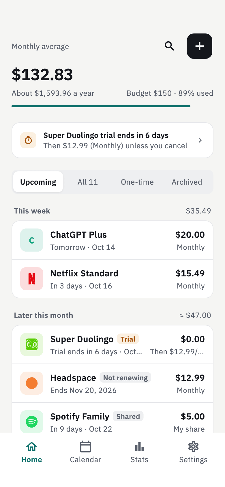
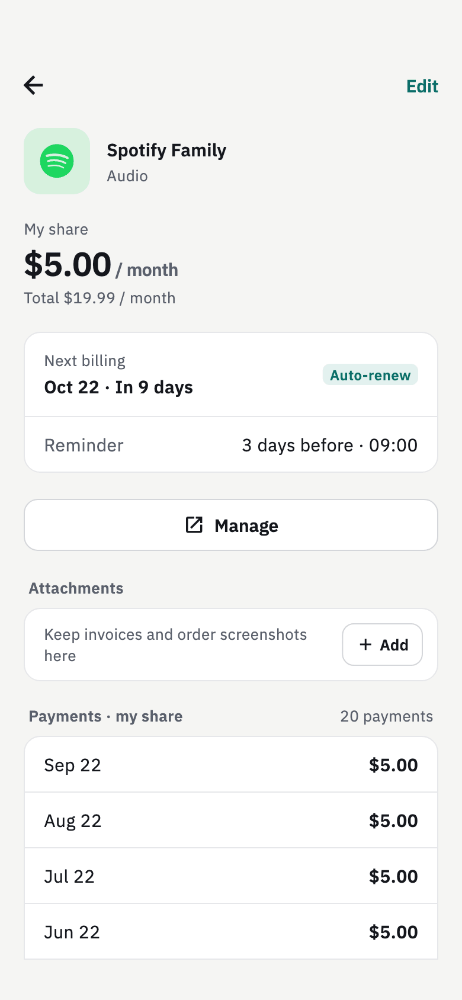
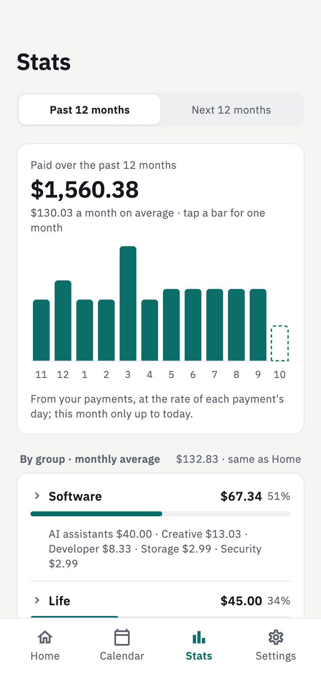
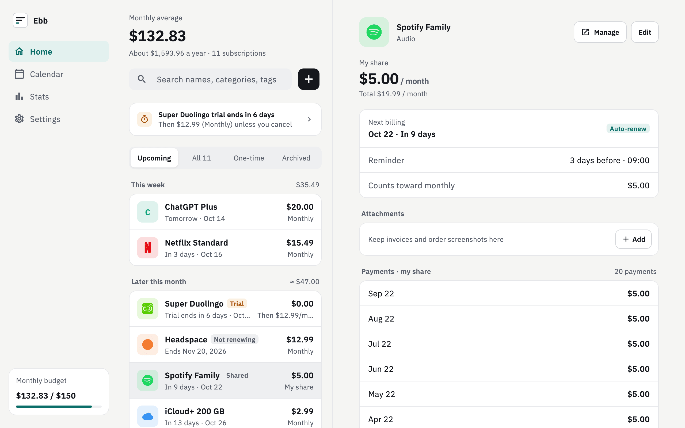

# Ebb

English | [简体中文](README.zh-CN.md)

**Ebb is a free, open-source, privacy-first subscription tracker for Android, macOS, Windows and Linux.** It shows what your subscriptions really cost each month, reminds you before every renewal, and keeps all data offline on your device: no account, no cloud, no telemetry.

[Website](https://unofn.github.io/ebb/) · [Download](https://github.com/unofn/ebb/releases/latest)

<p>
  
  
  
</p>



## Features

- **What you really pay each month.** Yearly and other plans are averaged into a monthly cost. Shared plans count only your share. Intro prices count at the regular price they return to.
- **Any currency.** Enter each subscription in its own currency; totals are converted to your base currency at the latest exchange rates.
- **Reminders** before each charge, plus trials, plans you won't renew, and an archive for cancelled ones.
- **Stats**: what you actually paid, a 12-month forecast, spending by group and category, overlapping services, a monthly budget and a quarterly review.
- **Import** from Tilla and SubscriptionManager.
- **Backups** as a single zip file you keep, CSV export, and receipts attached to subscriptions.
- English and Chinese, light and dark themes, phone and two-pane desktop layouts.

## Privacy

Everything is stored on your device. There is no account, no telemetry and no crash reporting. Ebb connects to only two places:

- [open.er-api.com](https://open.er-api.com) for exchange rates
- GitHub Releases, to check for a new version (you can turn this off in Settings)

## Download

Get the latest version from [Releases](https://github.com/unofn/ebb/releases/latest): an APK for Android, a universal dmg for macOS, an installer or portable zip for Windows, and a .deb or portable .tar.gz for Linux. The release notes explain how to open the app the first time, since the installers are not signed by Apple or Microsoft.

Supported systems: Android 10+, macOS 13+, Windows 10+, Ubuntu 22.04+. iOS isn't available yet.

## Build from source

With Flutter 3.47:

```sh
flutter pub get
dart run build_runner build
flutter run
```

Development notes (in Chinese) are in [AGENTS.md](AGENTS.md).

## License

[GPL-3.0](LICENSE)
