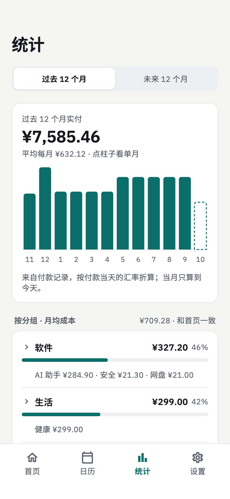
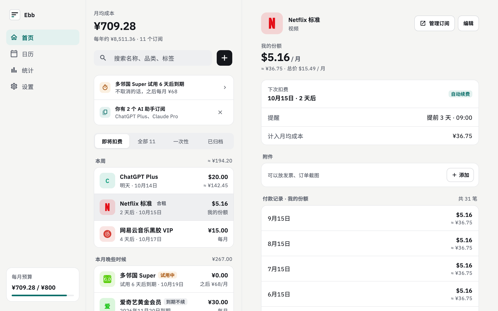

# Ebb

[English](README.md) | 简体中文

**Ebb 是一个免费、开源、注重隐私的订阅管理器，支持 Android、macOS、Windows 和 Linux。** 它帮你算清每个月在订阅上真正花了多少，扣费前提醒你，所有数据离线存在本机：没有账号，不上云，没有遥测。

[官网](https://unofn.github.io/ebb/zh/) · [下载](https://github.com/unofn/ebb/releases/latest)

<p>
  
  
  
</p>



## 功能

- **每月真正花多少**：年付等按月折算成月均成本；合租只算你的份额；首期优惠按恢复后的原价算。
- **多币种**：每个订阅按原币录入，汇总时按最新汇率折算成你的基准货币。
- **扣费前提醒**，以及试用、到期不续，退订的订阅可以归档。
- **统计**：实付历史、未来 12 个月预测、按分组和品类分析、同类重复提示、月度预算、季度复盘。
- **导入**：支持 Tilla 和 SubscriptionManager 的导出文件。
- **备份**成一个 zip 文件自己保存，可导出 CSV，订阅可以附上发票收据。
- 中文和英文界面，浅色和深色主题，手机单栏、电脑双栏布局。

## 隐私

所有数据都存在你的设备上：没有账号，没有遥测，也没有崩溃上报。Ebb 只连两个地方：

- [open.er-api.com](https://open.er-api.com)：获取汇率
- GitHub Releases：检查新版本（可在设置里关闭）

## 下载

到 [Releases](https://github.com/unofn/ebb/releases/latest) 下载最新版：Android 用 APK，macOS 用通用 dmg，Windows 有安装程序和免安装 zip，Linux 有 .deb 和免安装 .tar.gz。安装包没有经过 Apple、Microsoft 的签名认证，第一次打开的方法见发布说明。

支持的系统：Android 10+、macOS 13+、Windows 10+、Ubuntu 22.04+。暂无 iOS 版。

## 从源码构建

需要 Flutter 3.47：

```sh
flutter pub get
dart run build_runner build
flutter run
```

开发说明见 [AGENTS.md](AGENTS.md)。

## 协议

[GPL-3.0](LICENSE)
